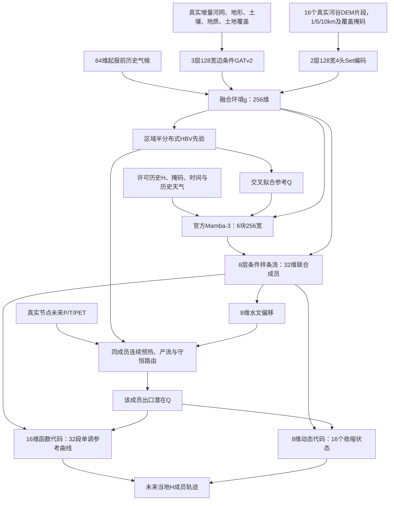

# 全套资料、完整模型与本地小样本实施对照

本轮依据原始定稿 PDF 第 3—6、8—9、15 章，以及保存的完整启动计划。执行顺序沿用用户最新要求：**整理完整真实资料 → 使用完整科学架构做少站本地试跑 → 固定资料与主模型 → 同资料消融 → 服务器扩大训练。** 本地阶段检查逻辑和可执行性，不能用极少优化步数判断最终模型精度。

机器可执行的数据定义：[完整资料库定义 v1](../01_数据准备/完整资料库定义_v1.yaml)。原始计划没有丢失，见[原始完整启动计划](第一阶段启动计划_原始完整.md)。

## 当前资料到底齐到哪里

| 资料 | 当前真实证据 | 接下来完成什么 |
|---|---|---|
| 历史 H、许可来源 Q | 已有 42 站水位模型视图，38 来源、1 验证、3 开发评估，14 个终端水系 | 按新 A—E episode 日期重建权限视图；现有目标式支持窗口不能直接当作 2018—2019 来源验证窗口 |
| 历史流域平均气象 | 现有 42 站 2011-10-01—2021-09-30 小时 P/T/PET | 可用于历史气候与基线；不能复制为节点空间气象 |
| 原网格气象 | Earthdata 认证已实测；首日 24 个小时文件全数核验；8 站真实节点面积聚合已生成 | 2011-10-01—2021-10-01 左闭右开共 87,672 小时下载已启动；完整覆盖后按时间块派生 |
| 河网与增量边界 | 42 站真实连接图与原始单元映射；26 站收缩图保留分支 | 部分站存在流域未映射面积差，须结合更细河网/分水岭资料核对；不把缺失面积人为塞给出口 |
| 流域静态属性 | 已从真实 HydroATLAS 站点表提取土壤、地质、地形、土地覆盖、冰川与冻土字段；42 站成表 | 这是站点/上游范围属性。取得增量单元属性后才形成完整节点张量，不能广播冒充局地属性 |
| 历史气候 | 42 站各有 64 个真实、起报前 P/T/PET 统计量 | 按 episode 起报检查截止日期；来源固定较早截止，不能把查询天气算进 g |
| 河谷 DEM | 11 块 USGS 3DEP 固定瓦片续传中，已有完整瓦片通过全块读取及哈希核验 | 下载完成后核验垂向基准、拼接所需区域，再提取地形；文件下载不等于河谷 token 已完成 |
| 河谷 16 片段 | 已有真实 DEM 投影、邻域与覆盖提取函数 | 仍需取得真实河道线和上下游位置，不能用流域多边形质心充当河谷片段 |
| MERIT/真实流路与节点环境补充源 | 原协议要求与资料用途已纳入清单 | 需实际获取。HydroATLAS 官方 Figshare 下载本次返回 HTTP 403，USGS NLDI 站点定位请求超时，已记录；尚未用其他数据冒充完成 |
| 完整主模型输入包 | 统一契约及缺项总账可执行 | 目前 **0 站**同时完成全部正式空间输入验收，不能把 8 站首日节点天气称为训练集已齐 |

动态状态见 `本地数据/审计/完整资料总账_v1/资料状态.json` 和 `逐站完整资料缺项.csv`；这两个文件由真实文件扫描生成，不是手工填的完成勾选。

原网格全时段压缩体量以已取得样例估算约 **162 GB（151 GiB）**，实际因小时而变；原计划 150 GB 工作预算需要上调，建议连同派生、DEM、节点环境和中间产物预留至少 300 GB。F 盘仍按实际剩余空间检查。全美网格一次取得后可服务更多候选流域，不为每站重复下载同一个小时。

## 冰川、积雪、河冰分别处理

**积雪是主模型过程，实测积雪不是新增的强制输入。** 原协议第 5.3 节要求雪储量、雨雪分配和融雪。现有 `hbv_step` 已由 P/T 驱动雪储量和温度指数融雪，雪融水进入土壤及快慢响应储量，水量闭合测试包含寒冷累雪与升温融雪。

原网格 `Tair` 为 K，转换一次为 °C；`Rainf` 与 `PotEvap` 是向后一个小时累计的 kg m⁻²，等价于该小时的 mm。原始负 PET 保留，同时单独生成非负蒸散需求。这些映射已用真实文件的 `time_bnds`、`units`、`cell_methods` 及 NASA README 表 3 核对。

**冰川融水没有在原协议中被规定为另一个必需生成模块。** HydroATLAS 的 `gla_pc_use` 来自 GLIMS 冰川范围资料，当前 42 站档案字段均为 0；这支持先用现有站点验证原主模型，但不等同于当代实地调查。`glc_*` 是土地覆盖，不能因为缩写相近把它误作冰川。

雪盖统计 `snw_pc_syr`、`snw_pc_smx` 来自多年 MODIS 雪盖。它们先用于描述站点和安排诊断，不作为未核验年代的环境 g 输入，避免多年统计跨过起报时刻。独立 SWE、雪盖时间序列可在主链稳定后用于过程检验；有显著冰川补给的新流域应明确扩展冰川面积、质量平衡与融水过程，不能声称现有雪融模块已包含冰川冰消融。

河道冰期会改变 H—Q 关系，属于原协议明确的挑战时期标记，与流域山地积雪、冰川覆盖是三件不同的事。

## 一套主模型的信息流



联合后验通过每个成员的 8 维地方水文代码调节 HBV 参数；同一成员代码贯穿两年预热、90 天动态暖启、支持期和未来。它并非只把事先固定的一条 HBV 流量送进一个水位回归器。目标当地 Q 始终不参与；推断的是与历史 H 相容的联合响应，不宣称唯一真实水文参数已被识别。

统一尺寸仍由[完整主模型配置](../02_模型训练/完整主模型_本地与服务器.yaml)控制。新增 `ProtocolHydrology` 与完整 `ProtocolECHO` 的地理/HBV 子树参数形状完全相同，阶段 A 不需要安装历史骨干即可准备。B—E 使用官方骨干，不能自动换成旧自写 SSM。

## 五阶段训练与推断现在的实现位置

| 阶段 | 新入口行为 | 验证边界 |
|---|---|---|
| A | 完整地理/HBV前端训练；all-source及按水系三折前端；逐站参考Q缓存、来源固定曲线节点统计 | 已有训练控制和子树一致性测试；尚未在完整真实空间输入上训练 |
| B | 只用来源交叉拟合参考Q、历史H训练静态响应，关闭水文地方偏移和动态项 | 验证选择仅使用来源验证水系 |
| C | 冻结历史后验和静态生成器，打开动态响应；参考Q在支持前90天暖启 | 不把阶段C冻结当成无记忆消融实验 |
| D | 同成员重算HBV；支持似然、查询CRPS、来源Q、KL退火、曲线平滑与静态锚定 | 冻结共享地理/HBV先验，训练地方偏移及响应模块 |
| E | 来源验证选检查点并估计低阶相关残差；冻结共享权重 | 残差不跨站、不跨缺测连接；成员分歧与总区间分别保存 |
| 目标推断 | 输入只有历史H与许可环境/天气；输出未来成员、时间、版本 | 开发目标输入清单不能指向未来标签文件；评分另行读取 |

核心代码为 `src/echo/training/protocol_engine.py` 和 `protocol_pipeline.py`。阶段 A 的交叉拟合、B—E 优化器/冻结/检查点/校准已有离线控制测试；测试使用明确标记的小型数值替身隔离调度，**不代表官方 Mamba 或完整主模型已经在 GPU 上运行通过**。

完整数据入口拒绝接收 `complete_spatial_inputs_verified=false` 的清单。它也拒绝将验证水系 Q 载入 H-only 验证任务，以及将未来目标 H 加入预测对象。新入口不会自动读取旧替代模型的空间 NPZ。

## 本地试跑的验收顺序

1. 原网格、真实节点属性、真实河谷16片段、边属性和基准全部形成收据；解决或明确隔离未映射面积问题。站点顺序保持固定，不按预测成绩换站。
2. 为同一8站建立完整 episode：保留真实日历预热、各角色正确时段及来源三折；首轮少量7天支持/7天查询用于工程检查，全年与各预算仍在同一接口执行。
3. 在 Windows 可先运行完整阶段 A。B—E 需要固定官方 Mamba-3 的 Linux CUDA 环境；本机 WSL2 可继续使用同一块笔记本 GPU，算力不会因此增加。
4. 使用同一完整架构、batch=1、worker=0、少优化步数运行五阶段；检查有限值、水量、单调性、动态回归、成员一致、恢复一致与未来H隔离。
5. 固定代码、资料、划分和主模型；再在相同未来、相同观测预算上做冻结/去模块消融。正式效果、三个种子、全年和大样本仍需充分训练后验收。

主模型全链未执行前，既有静态/动态替代模型成绩继续保留为开发记录，不转写为新主模型的精度证据。

## 操作入口

```powershell
# 当前完整资料、下载与节点气象状态
.\06_运行脚本\查看完整模型资料状态.ps1
& .\本地环境\python.exe -m echo.data.project_inventory

# 需要中断恢复时再运行，已有下载进程在运行时不要启动第二个写入者
.\06_运行脚本\下载原网格历史气象.ps1 -开始 '2011-10-01T00:00:00Z' -结束 '2021-10-01T00:00:00Z'

# 原网格节点气象按新版本目录生成，不能覆盖已有派生收据
& .\本地环境\python.exe -m echo.geo.nldas_inputs --help

# 环境只读检查；--exercise仅在Linux官方CUDA环境中执行真正前向反向
& .\本地环境\python.exe -m echo.training.protocol_doctor
& .\本地环境\python.exe -m echo.training.protocol_pipeline --help
```

输入格式见[完整主模型数据清单说明](../02_模型训练/完整主模型数据清单说明.md)，Linux准备见[完整主模型Linux与WSL2准备](../07_环境配置/完整主模型Linux与WSL2准备.md)。
