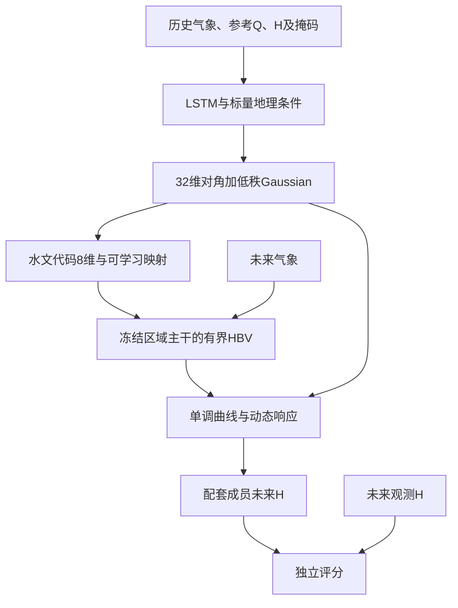

# 本地逻辑验证与服务器准备

2026-10-23。当前目标是在笔记本上验证研究逻辑、数据权限和训练推断连接，准备可扩容的数据资产，再迁移服务器做完整模型和大规模实验。原始研究目标与[完整启动计划](第一阶段启动计划_原始完整.md)保持一致。

## 📍 已经完成与正在推进

| 内容 | 当前实际状态 |
|---|---|
| 来源Q水文前端 | 248站、39水系；区域HBV及三折均完成30轮 |
| H数据视图 | 38来源站、10水系；1验证站、3开发站；共42站 |
| 参考Q | 42站已生成并封存；来源站使用未训练其所属水系Q的前端 |
| 确定性ECHO | 静态和动态各10轮及三个开发站完整未来年评分已完成 |
| 真实概率链 | 本轮新增六来源水系、2轮、7天支持和24小时查询的小样例；具体完成状态见对应运行结果文件 |
| 全量H训练集 | 尚未完成；已有逐站补证与准备待办，保留固定水系角色 |
| 双尺度静态编码和Mamba-3 | 尚未实现并验证；不能用现有标量地理/LSTM效果代替 |
| 服务器部署与正式训练 | 尚未进行；先准备数据资产清单、版本和迁移校验 |

## 🧭 这次要验证的联合逻辑



32维地方代码仍分为水文8维、曲线16维、动态8维。本地新增秩4相关Gaussian可以表达三组之间的相关性；它是条件分布开发近似，不能当作正式条件样条流。多个成员批量递推，整个未来段不会重新采样或重配参数。

来源训练时，H支持拟合、来源Q约束、未来查询H评分及KL约束共同更新地方推断与水文偏移映射。区域HBV主干冻结，目标站只由历史H和环境条件推断地方代码。目标Q、未来H均不用于适配；“HBV适配”指地方代码改变有界HBV参数，并不表示重新训练区域HBV主干。

## 🕒 站点、时间与本地算量

水文预训练用2011-10至2019-10气象，其中前两年预热，2013-10至2018-10来源Q监督，2018-10至2019-10来源时间验证。42站H视图气象覆盖2011-10至2021-10。

确定性ECHO来源训练期2013-10至2018-10，历史预算7、30、90天及完整水文年，查询168小时。新联合小样例仍在该来源训练期内抽样，缩成7天支持、24小时查询、两个训练成员；来源验证预先固定2018-11、2019-03和2019-07三个窗口。

小样例选择6个来源站，分别来自6个不同来源水系，覆盖原冻结三折，各折两个水系：01081500、01208990、02235200、02401000、02365470、08084800。名单只依据固定来源角色与折号，不依据开发评分。

小样例目标预测仅使用最后7天支持H和未来24小时气象、16个成员，分别对1验证站及3开发站评分。它与前一轮“完整支持年/未来年”的结果不具备相同预算，不能直接排模型名次。

## 🗃️ 数据扩容与迁移准备

新增准备程序只依据固定角色、原有覆盖元数据、独立历史证据和现有模型视图生成待办，不按预测误差删站。拓扑、面积和气象条件下，冻结82个水系内共有789个元数据候选站；其中422站通过原始目标H覆盖门槛。789并不表示789站已获准训练。

当前289个来源候选中248站已进入Q预训练视图，38站进入H训练视图；H扩容需继续逐站核对Q/H时间语义、历史水尺基准和来源支持/查询覆盖。目标站只补历史H证据；盲测水系继续预留。

运行入口：

```powershell
& ./本地环境/python.exe -m echo.data.readiness --output 本地数据/审计/新的准备版本
& ./本地环境/python.exe -m echo.data.readiness --verify 本地数据/审计/本地闭环与服务器准备_20261023_v2/服务器迁移文件清单.json --root .
```

现有v2清单包括515个数据与证据文件，合计264444876字节，约252MiB；原始26GB档案保留本机，需要从原始文件重建时另行迁移。清单中评分标签单独标为仅评分，未纳入盲测时序。

迁移清单只确认资产完整性。现有索引、参考封存及检查点仍含Windows路径和原始数据哈希绑定，必须显式建立路径映射和新绑定记录，再在Linux重跑完整性及短流程测试；不能直接把清单改称服务器可运行数据集。

## ✅ 本地验收后再扩大训练

1. 保留确定性年度结果；联合小样例应完成真实训练、后验诊断、HBV参数变化检查及四目标短查询独立评分。
2. 数学、信息权限和完整接口测试通过；检查后验协方差正定、适配梯度、同成员配套及未来H隔离。仅有有限值和参数变化不证明概率校准有效。
3. 汇总全部候选站的证据缺口，形成固定训练/验证/开发/盲测角色下的扩展数据版本；双尺度流域/河谷静态输入单独准备。
4. 在服务器验证Linux环境、正式Mamba-3和空间模块，再用同一信息权限开展全流域训练、来源水系验证、三种子与消融。最后锁定概率校准再运行盲测。

最新确定性结果见[真实闭环报告](../05_结果分析/扩展ECHO确定性闭环_20261023.md)。已有Gaussian小样例的状态以`本地运行/扩展水位训练_v2/ECHO联合推断_本地小样例_v1/联合逻辑验证结果.json`实际文件为准，未生成该文件就不算完成。
