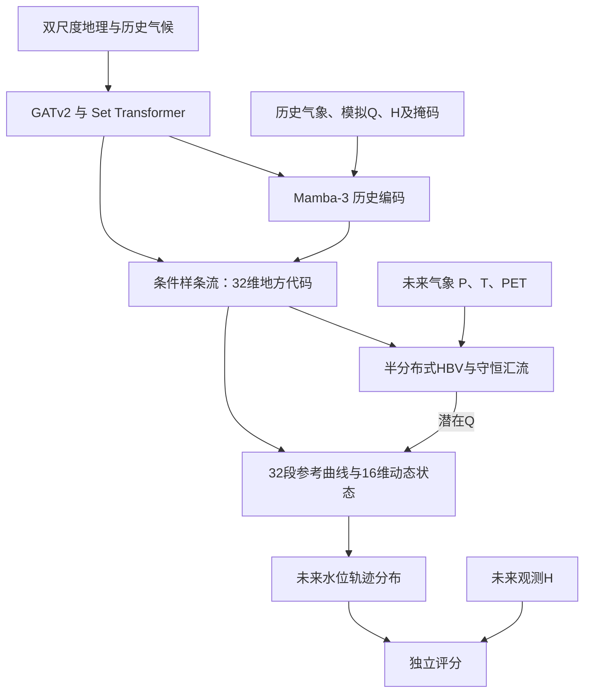

# ECHO 模型结构与实现对照

_2026-10-22：对照定稿协议、第一阶段原始计划及实际代码，用于研究与实施核查。_

---

## 📋 先回答目前做到哪里

目前使用的是 **HBV** 水文前端。它是项目中可微的单节点HBV式开发实现，包含雪、土壤、快慢储库和线性汇流；没有采用名为HPV的水文模块。不能把当前开发代码称为已经实现的完整半分布式正式模型。

研究目标仍是：新水系没有当地实测Q，利用许可历史H、气象和独立地理，预测未来当地水尺基准下的H。第一阶段使用实际未来气象，属于给定气象条件模拟；还不是真实天气预报实验。

完整HBV及三折来源模型、八站参考Q、三个目标站的两种真实基线都已运行完成。静态、动态、Gaussian与直接LSTM已有代码和合成检查；各自的真实训练/评分须以实际运行记录逐项验收。约100站、三个种子、消融和论文正式骨干尚未完成。

依据为本地定稿协议第4—6、9章，以及[用户确认的完整第一阶段计划](第一阶段启动计划_原始完整.md)。二者的关系是：正式架构规定最终研究目标，第一阶段计划明确允许先用LSTM、标量地理、单节点HBV和对角Gaussian检验数据及接口。

## 🧭 正式模型的信息流

主模型先用历史推断地方解释，随后固定地方代码和共享权重。每个概率成员在整段未来中保持自己的水文、曲线和动态代码配套；状态逐小时推进。未来H不能重新进入适配，未来天气不能绕过Q直接进入ECHO的水位残差。直接水位神经网络是另列的基线。

## 🧩 当前开发版与正式版逐项对照

| 模块 | 正式协议 | 当前开发实现 | 完成边界 |
|---|---|---|---|
| 地理 | 双尺度；GATv2、Set Transformer、历史气候融合 | 面积、坡度、地形起伏、经纬度5个标量，经来源站标准化 | 标量接口可用；无空间地形编码 |
| 产汇流 | 默认8个增量子流域，可至32节点 | 单节点，雪/土壤/快库/慢库/路由库 | 真实HBV及三折完成；非正式空间模型 |
| 历史编码 | Mamba-3，6块、宽256、内部状态128 | 两层LSTM、隐藏宽64；输入8维历史token | 代码与合成检查完成；逐模型做真实训练 |
| 地方推断 | 32维条件样条流，8层、每层8 bins | 32维对角Gaussian；确定版取后验均值 | 不具备完整跨组后验协方差 |
| 参考曲线 | 32正斜率段；来源参考Q范围固定节点 | 32正斜率段，当前固定步宽0.2，正斜率外推 | 单调性已测；节点规则是开发近似 |
| 动态响应 | 8个二维阻尼旋转块，16状态 | 已实现同类变化驱动收缩算子及零态中心化读出 | 性质已测；真实增量收益待验证 |
| 概率输出 | 配套联合成员、来源校准残差、天气误差分开 | 固定地方成员；Gaussian开发链 | 不是完整总预报区间 |
| 训练/评估规模 | 百站起步，扩展千站、三种子 | 当前5来源、1验证目标、2开发目标，单种子 | 只能作为试运行证据 |

正式配置保存在[尚未接入的正式模型配置](../02_模型训练/正式模型配置_尚未接入.yaml)。配置文件存在不表示其中模块已经可运行；代码遇到未实现的骨干会报错。

## 💧 HBV具体做什么

每小时读取P（mm/h）、T（摄氏度）和PET蒸发需求（mm/h），维持5类非负储量：雪、土壤、快响应、慢响应和路由。地理MLP生成9个有界参数，分别控制土壤容量、非线性产流、蒸散限制、融雪、融雪阈值、渗漏、快退水、慢退水和路由时间。

每一步检查的水量关系是：

$$
S_{t+1}-S_t=P_t-E_t-R_t.
$$

这里储量与通量按毫米及一小时时间步计算。径流深变为流量使用：

$$
Q_t=R_t A/3.6\quad[\mathrm{m^3/s}],\qquad A\text{以}\mathrm{km^2}\text{计}.
$$

曲线的规范化尺度另为$q_*=A/86.4$，表示1 mm/day的面积流量尺度。两个分母对应不同用途，不能混用。

实现位置：[HBV](../src/echo/hydro/hbv.py)、[线性库与河网接口](../src/echo/hydro/routing.py)。单节点用等效小时库表达汇流，多节点路由函数已做守恒测试，但真实增量子流域与空间气象尚未接入。模型给出有效潜在Q，不能据水位拟合成功宣称已经恢复唯一真实Q或真实水力参数。

水文气象至少预热两年，动态响应在支持期前预热90天。P/PET按此前一小时累计量处理，H和T按整点瞬时值处理；统一步末时间索引。PET保留原始负通量记录，开发模型蒸发需求取正部。

线性路由返回步平均出流，而USGS来源Q核验的是整点瞬时记录：小时模型以此作离散近似，不把两种时间支持宣称为严格相同。正式物理解释前还须用时间步/时间支持敏感性试验检查洪峰相位影响。

## 🧠 历史如何变成地方水位响应

当前token为历史P、T、PET、参考模拟Q变换、规范化H、H有效掩码、距上次观测时间和相对时间位置。参考Q来自许可来源训练的前端；源站也必须使用未见自身水系Q的留折前端。编码器绝不直接读当地实测Q。

32维地方代码分为：水文修正8维、静态曲线16维、动态8维。确定版只使用均值；静态版不打开水文修正及动态模块。Gaussian开发版允许水文低秩修正，HBV共享权重保持冻结；当前偏移映射也随前端冻结，不能称为已完成所有联合方向的学习。

单次生成的曲线、地方代码在整个预测轨迹中复用。用支持期H中位数$m_H$、$s_H=\max(\mathrm{IQR},0.1\,\mathrm m)$还原米制水位：

$$
\widehat H_t=m_H+s_H\{b+G(u_t)-G(u_{ref})+r(z_t)\},\quad
u_t=\log(1+Q_t/q_*).
$$

$G$由32个正斜率生成，$u_{ref}$由支持期参考模拟Q确定。静态版取$r=0$。动态版用$\Delta u$、$\Delta^2u$驱动8个二维状态块；门控不读旧状态，阻尼严格收缩，显式实现$r(0)=0$。恒定Q下偏离逐步衰减，不把这些16维有效状态叫作16个真实河道储量。

代码位置：[历史与Gaussian](../src/echo/models/context.py)、[曲线](../src/echo/models/curve.py)、[动态状态](../src/echo/models/dynamics.py)、[统一ECHO生成器](../src/echo/models/echo.py)。

## 🔍 哪些已检查，哪些仍需研究

| 项目 | 当前证据 | 不能据此推出 |
|---|---|---|
| 目标Q权限 | 目标NPZ物理移除Q；检查点来源水系清单排除全部固定目标水系 | 所有候选站的拓扑已无歧义 |
| 来源交叉拟合 | 8站Q逐站按对应检查点重算，并封存缓存/权重/索引哈希 | Q是唯一或真实无误的流量 |
| 未来H隔离 | 实际预测API在评分标签改变、标签读取被禁止时给出相同预测 | 小样本泛化已获证 |
| 未来天气路径 | 固定Q时改变未来天气不改变静态/动态ECHO输出 | 真实业务天气预报误差已计入 |
| 数学结构 | 储量非负、水量闭合、单调外推、收缩、恒定Q回归及分块检查 | 已验证所有真实河流水力机制 |
| 实测性能 | 3目标站两种基线真实评分；一站改善、一站恶化 | ECHO优于基线或总体显著获益 |

现有ECHO训练的停止依据是来源站2018-11-01起的固定7天查询窗口，前接30天支持；这属于来源验证水文年内的试运行窗口，不能写成“已经完成全年来源验证”。扩大来源验证日期和事件覆盖、固定停止规则后，需要按同一规则重跑正式比较。

其他明确开发近似：标量地理、单节点、对角Gaussian、固定曲线节点、长历史生成梯度截断至最近720小时、简化支持损失、尚无来源校准的相关残差和完整空间验证。它们需要分别验收，不能用单元测试通过替代科学效果证据。

## 📚 计划与结构证据入口

- [用户确认的完整启动计划](第一阶段启动计划_原始完整.md)：保留原始约定。
- [后续执行与验收清单](后续执行与验收清单.md)：当前工作顺序、验收与剩余任务。
- [当前交付与后续验收](当前交付与后续验收.md)：状态摘要。
- [首批真实基线对照](../05_结果分析/首批真实基线对照.md)：实测结果及失败案例。
- 协议原件：本机`F:\博士课题研究\ECHO_NatureWater_Final_Research_Protocol_ZH.pdf`，重点第4—6章和第9章；本次核对包含原页架构图、HBV单位公式和汇流公式。
