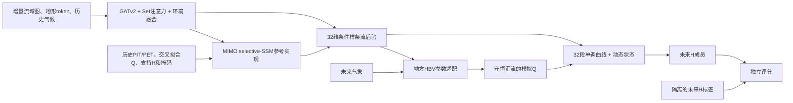

# 正式架构小样本真实闭环

本轮把若干正式 ECHO 模块概念接成可训练、可预测、可独立评分的本地替代链路，并在有限真实数据上运行。结论是**替代实现的工程链路可行；它与定稿协议的内部结构并不完全一致，预测收益和概率可靠性也未通过**。逐项差异见[定稿协议一致性审计](../00_项目说明/定稿协议一致性审计_20261023.md)。

## 本轮运行

来源训练选取4个不同水系、覆盖既定3个交叉拟合折的站点：01081500（fold 1）、02365470（fold 2）、02401000（fold 0）、08084800（fold 2）。每站抽取一个2013-10至2018-10的短episode，使用7天H支持、7天查询、7天HBV暖启、2个训练成员和1轮优化。来源查询期H/Q用于训练损失；支持期H进入历史编码。

预测阶段使用1个验证站和3个开发站。每站只把支持期H、气象、独立空间属性和来源交叉拟合参考Q送入模型；未来H不进入预测输入，评分阶段再从单独的标签文件读取未来168小时观测。支持预算固定为7天。训练、预测和评分均成功，没有程序失败。

本地小样本配置复用了部分正式模块族，但既有尺寸缩减，也有结构和输入替代：MIMO-SSM参考实现宽64、状态16、2块；后验为32维、8-bin有理二次样条流但缩为4层；实际HBV节点由深度分带串联，站点样本3—8节点。它不是协议定义的真实分叉河网半分布式HBV，也没有加载该结构的阶段A预训练权重。

当前空间输入由HydroBASINS子流域多边形与CAMELS/HydroATLAS流域汇总地形属性构造；没有本地高分辨率DEM。16个token不是协议中的河谷片段，邻域特征为距离分箱指示量。河网带被串联成链，真实分支拓扑未保留。现有强迫是流域平均气象并复制到每个增量节点，不具备空间降雨差异。超出拓扑映射的面积比例按站点记录。这些属于输入和拓扑替代，不应写成完整真实空间模型。

历史骨干是自写的可微Torch selective-SSM参考扫描。Windows环境没有可用的官方Mamba-3实现，因此本轮没有运行协议指定的Mamba-3。GATv2、Set注意力、条件样条流、HBV参数适配、响应曲线和动态状态均实际参与反向传播；但HBV从随机初始化开始，只有7天中性代码预热，动态状态没有协议要求的支持前90天预热。这些差异会改变成员所代表的水文和动态解释。

## 同窗结果

下表使用相同3个开发站、7天历史支持、紧接其后的未来168小时。旧版模型有明显更多来源数据和训练量，因此这是小样本诊断比较，不是控制了训练规模的结构消融。

| 模型 | 开发站等权RMSE (m) | 开发站等权MAE (m) | 说明 |
|---|---:|---:|---|
| 持续性 | 0.136 | 0.120 | 同站、同支持与查询窗口 |
| 直接水位LSTM | 0.113 | 0.101 | 既有扩展训练模型 |
| 静态ECHO | 0.113 | 0.102 | 既有扩展训练模型 |
| 动态ECHO | 0.096 | 0.083 | 既有扩展训练模型 |
| 正式架构缩小版 | 0.186 | 0.174 | 4来源水系、每站1个episode、单种子、1轮 |

正式架构缩小版逐站RMSE为：01017000 0.076 m、01122500 0.050 m、02371500 0.431 m。较差站点保留在汇总中。正式架构不确定性成员区间仍很窄，90%覆盖率为0%，不能用于可靠概率结论。验证站11465200的168小时RMSE为0.010 m；单验证站且短窗口，不能代表跨水系验证性能。

地方样条在该7天窗口的复核出现极端数值发散（RMSE约1.4×10^11 m），因此记为失败实现，不纳入有效胜负表；需先查明支持Q拟合条件和外推数值稳定性，再作比较。

旧版ECHO训练使用更多来源站、更多episode和多轮优化；本轮完整结构只有4个来源水系、4次参数更新、单随机种子。正式架构当前落后旧动态ECHO，不能把该差值解释为架构本身无效；它说明当前小样本训练预算不足以支持精度判断，同时暴露出一个较差开发站及概率欠覆盖问题。

## 证据边界与接续

- 这轮验证的是7天条件模拟，不是协议要求的整年未来区间，也不是真实天气预报。
- 本地计算缩减配置保留了模型路径，没有证明全尺寸Mamba-3、8层条件流或正式成员数能在笔记本运行。
- 单个训练episode/来源和单种子没有充分优化共享参数；不报告为最终精度。
- 目标Q未读入模型或归一化。目标未来H仅由评分程序读取。来源站按原冻结水系角色和折号核验。
- 后验虽已采样，但概率区间欠校准。下一轮首先提高来源水系与episode数、增加训练轮次，并在来源验证期选择停止规则；然后检查02371500和极端Q外推，重新作同预算比较。
- 全规模拓展仍须收集和整理完整站点资料，转至Linux GPU后验证官方Mamba-3及所需真实空间强迫，再进行多种子、消融和整年开发评估。
- 本次试跑不作为“最终架构已搭建完成”或“仅因样本量小而精度不足”的证据；空间输入、河网、阶段A初始化、动态初态和训练目标均需先与协议对齐。

复现配置为[最终架构本地小样本](../02_模型训练/最终架构_本地小样本.yaml)，启动脚本为[运行正式架构本地小样本](../06_运行脚本/运行正式架构本地小样本.ps1)。本机权重、逐站预测与评分表保存在`本地运行/正式架构_本地小样本_v3`及`本地运行/正式架构_同窗比较_v1`，不纳入Git。
